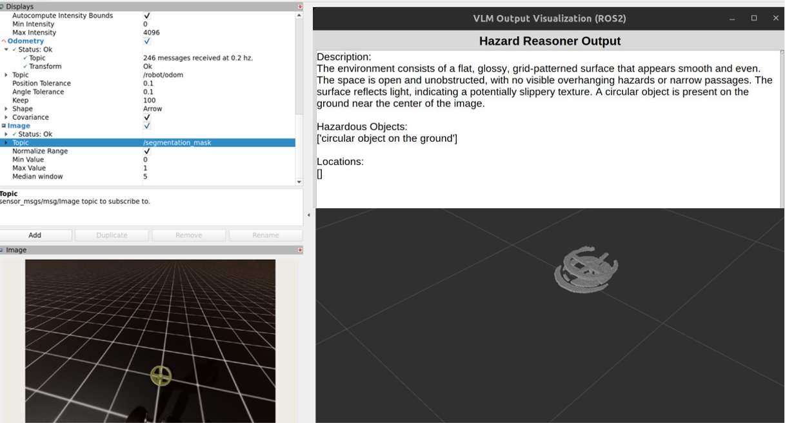
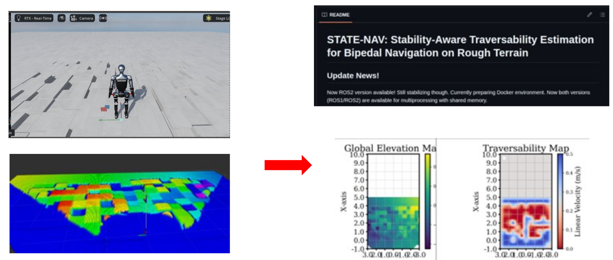

---
title: "VLM-aided interactive navigation for humanoids in cluttered indoor and outdoor rough terrain"
excerpt: "This is my new ongoing project. Using vision foundation models such as DINO, SAM and VLMs for semantic understanding of human-centered cluttered environment and outdoor terrain. Working on Isaac. First results are published as [HINT-VLM](https://arxiv.org/abs/2611.11665) (CoRL 2026 SISREN Workshop) with an embodiment-grounded VLM; now extending it to world-model-based loco-manipulation reasoning.  "
collection: portfolio
---